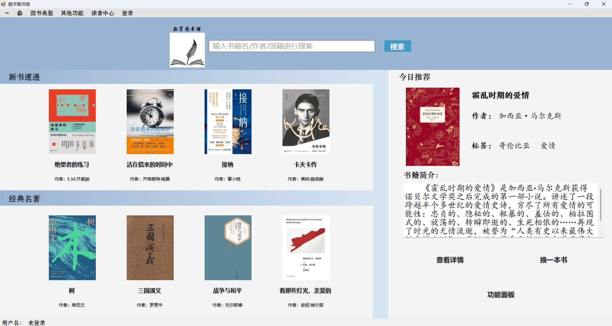
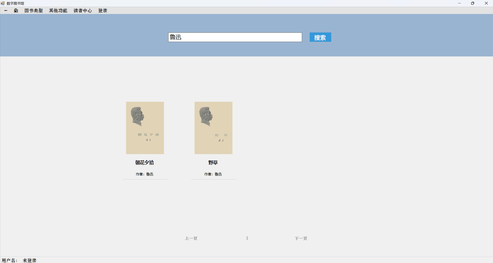
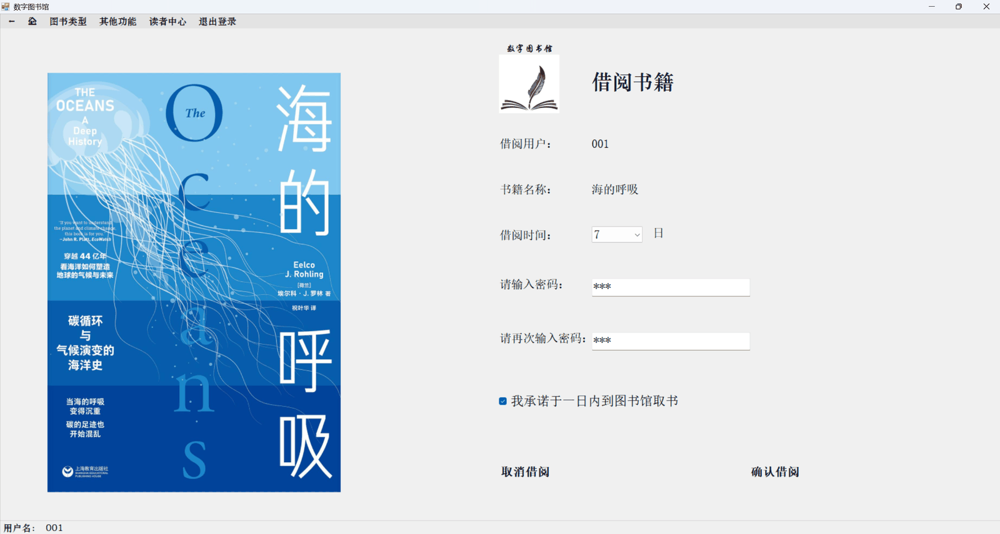
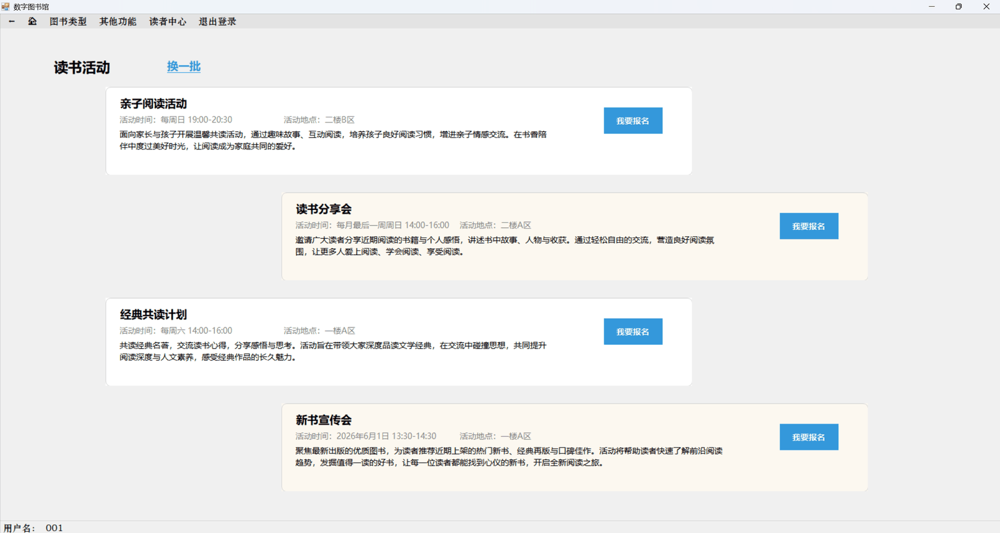
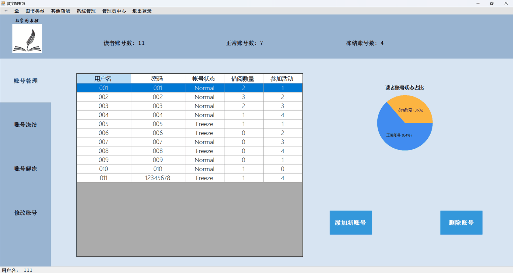
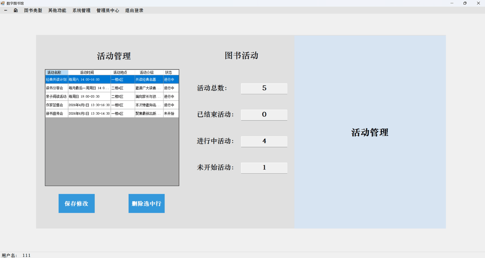
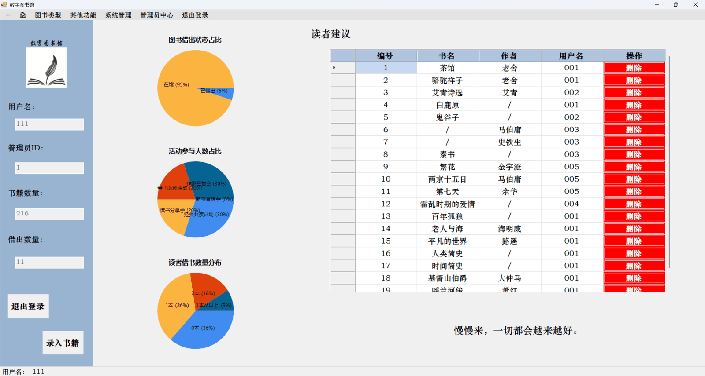

# 数字图书馆管理系统（Digital Library）

> 一套基于 **C# / .NET Framework 4.7.2 + WinForm** 开发的图书馆管理系统，覆盖图书检索、借阅归还、读者与管理员双角色运营、活动发布、馆际互借（云桥连）以及 AI 智能荐书，数据存储于本地 MySQL。项目为本科毕业设计作品，侧重完整业务闭环与桌面端工程实践。

---

## 目录

- [一、项目简介](#一项目简介)
- [二、功能特性](#二功能特性)
- [三、运行截图](#三运行截图)
- [四、技术栈](#四技术栈)
- [五、系统架构与设计](#五系统架构与设计)
- [六、环境要求](#六环境要求)
- [七、运行步骤](#七运行步骤)
- [八、配置说明](#八配置说明)
- [九、数据库设计](#九数据库设计)
- [十、项目结构](#十项目结构)
- [十一、核心业务流程](#十一核心业务流程)
- [十二、常见问题（FAQ）](#十二常见问题faq)
- [十三、安全性与后续改进](#十三安全性与后续改进)
- [十四、说明与致谢](#十四说明与致谢)

---

## 一、项目简介

本项目是一套 **单机客户端 + 本地 MySQL** 的数字图书馆管理系统，采用 WinForm 实现图形界面，通过 ADO.NET（MySqlConnector）直连数据库。系统面向高校图书馆场景，区分 **读者** 与 **管理员** 两类角色：

- **读者**：注册登录、检索图书、查看详情、借阅 / 归还、浏览活动并报名、检索分馆藏书（云桥连）、与 AI 对话获取荐书。
- **管理员**：图书录入、读者账号管理、活动管理、分馆书目维护，并在管理员中心查看馆藏与借阅统计图表。

项目亮点：

- **AI 智能荐书**：调用本地大模型（Ollama + qwen:7b），从自然语言提问中提取作者 / 分类关键词，检索馆藏后生成友好推荐话术，并通过提示词约束「只使用真实馆藏、禁止虚构书籍」。
- **云桥连（馆际互借）**：独立的 `book_branch` 分馆书目，支持模糊检索、分页浏览、借阅与「未到 / 已到」状态管理。
- **自定义 UI 框架**：无边框窗体、圆角控件、渐变标题栏、卡片式书目展示，以及基于 `Panel + Stack` 的多页面导航（支持返回上一级 / 返回主页）。
- **数据可视化**：管理员中心与账号管理页使用 `DataVisualization.Charting` 绘制饼图，直观展示借阅状态、活动参与、账号状态等统计。

---

## 二、功能特性

### 2.1 读者端

| 功能      | 说明                                                                                |
| ------- | --------------------------------------------------------------------------------- |
| 登录 / 注册 | 账号密码校验，区分 `reader` 与 `administrator` 两类身份                                         |
| 主页      | 新书速递（按出版日期取最新 10 本，再随机展示 4 本）、经典名著（经典/小说/散文随机 4 本）、随机推荐一本；三处均只从在馆可借的书里挑选，另有功能快捷面板 |
| 图书检索    | 按书名 / 作者 / 分类 / 国籍模糊匹配，分页浏览（每页 4 本）                                               |
| 图书详情    | 展示书名（中/英）、作者、国籍、出版时间、分类、简介与封面；可查询存放位置或借出状态                                        |
| 图书借阅    | 选择借期（3 / 5 / 7 / 15 / 30 天）、两次密码校验、勾选借阅协议；每人借阅上限 3 本                              |
| 图书归还    | 输入用户名查询在借图书，支持多选批量归还；可修改 / 延长归还时间                                                 |
| 读者中心    | 展示账号信息、在借图书卡片（含剩余归还天数）、提交荐购建议                                                     |
| 活动中心    | 随机展示活动卡片，读者可一键报名（校验身份与重复报名）                                                       |
| 云桥连     | 检索分馆藏书（书名 / 作者 / 分类 / 国籍），分页浏览（每页 3 本）与详情查看                                       |
| AI 智能荐书 | 对话式输入需求，AI 结合馆藏返回推荐书目                                                             |

### 2.2 管理员端

| 功能    | 说明                                                                   |
| ----- | -------------------------------------------------------------------- |
| 管理员中心 | 展示馆藏总量、借出数量；三张饼图（图书借出状态、活动参与人数、读者借书数量分布）；处理读者荐购建议（可删除）；随机鼓励语         |
| 图书录入  | 录入书名 / 英文名 / 作者 / 国籍 / 出版时间 / 分类 / 简介 / 存放地点，并上传封面图片；录入成功后自动清理同名荐购建议 |
| 账号管理  | 读者账号的新增、删除、冻结、解冻、编辑与批量保存；展示账号总数 / 正常 / 冻结统计及状态饼图                     |
| 活动管理  | 活动的新增、编辑、删除；按「已结束 / 进行中 / 未开始」统计；删除活动时同步重置读者的报名关联                    |
| 云桥连管理 | 分馆书目按「未到 / 已到」分组展示，支持批量切换到馆状态                                        |

### 2.3 系统与通用

- **多页面导航框架**：以 `Navigation` 为主壳，子窗体承载于 `Panel`，用 `Stack` 记录页面历史，支持返回上一级、返回主页、退出登录。
- **角色权限控制**：根据登录身份动态切换菜单（读者中心 / 管理员中心 / 系统管理）与页面按钮。
- **自定义控件**：`BookCard`、`LendBookCard`、`CBCBookCard` 等书目卡片控件，复用书目展示逻辑。
- **统一数据访问**：`MySQLConnect` 封装连接、查询、更新与连通性检测。

---

## 三、运行截图

> 以下为系统主要界面的运行截图，图片存放于仓库 `docs/screenshots/` 目录。

| 截图 | 说明 |
| --- | --- |
|  | 主页（新书速递 / 经典名著 / 今日推荐） |
|  | 图书检索结果 |
|  | 借阅确认页 |
|  | 活动中心（读者报名） |
|  | 账号管理（冻结 / 解冻 / 修改 / 状态饼图） |
|  | 活动管理（新增 / 编辑 / 状态统计） |
|  | 管理员中心（馆藏与借阅统计） |

---

## 四、技术栈

| 类别      | 技术 / 版本                                                                                            |
| ------- | -------------------------------------------------------------------------------------------------- |
| 开发语言    | C#                                                                                                 |
| 运行框架    | .NET Framework 4.7.2（WinForm 桌面应用）                                                                 |
| 数据库     | MySQL 5.7+ / MariaDB 10.x（开发环境为 MariaDB 10.5，端口 3307）                                              |
| 数据库访问   | MySqlConnector 2.5.0（ADO.NET，`ExecuteQuery` / `ExecuteNonQuery`，用户输入一律通过参数传入）                      |
| 配置管理    | `System.Configuration`（`App.config` 的 `appSettings` + `AppConfig.cs` 统一读取）                         |
| AI 能力   | 本地 Ollama 运行 `qwen:7b`，用 `HttpClient` POST 调用 `/api/generate`，Newtonsoft.Json 解析返回，不依赖任何第三方 AI SDK |
| JSON 处理 | Newtonsoft.Json 13.0.4                                                                             |
| 图表      | System.Windows.Forms.DataVisualization（饼图统计）                                                       |
| 依赖管理    | NuGet（`packages.config`）                                                                           |
| 开发工具    | Visual Studio 2019 及以上                                                                             |

---

## 五、系统架构与设计

系统采用经典的 **UI 层 → 数据访问层 → 数据库** 结构，单进程桌面应用：

```
UI 层（WinForm）
  Program → Navigation（主壳 / 菜单 / 导航栈）
  读者页：HomePage / Search / Details / LendBook / ReturnBook /
          ReaderCenter / ActivityCenter / CloudBridgeConnect / AIBook
  管理页：AdministratorCenter / EnterBooks / ManagementAccount /
          ManagementActivities / ManagementCBC
  自定义控件：BookCard / LendBookCard / CBCBookCard
        │
        ▼
配置层 AppConfig  ←  App.config（appSettings）
  DbHost / DbPort / DbUser / DbPassword / DbName / ImageFolder / OllamaEndpoint
        │
        ▼
数据访问层 MySQLConnect（全部参数化查询）
  ExecuteQuery / ExecuteNonQuery / Param / TestConnection
        │
        ▼
数据库 MySQL / MariaDB（digital_library）
```

**设计要点：**

1. **单一入口与主壳**：`Program.Main` 启动 `Navigation`，后者作为常驻主窗体统一管理菜单、用户状态与子页面。
2. **基于栈的页面导航**：子窗体以非顶级控件形式加入 `_mainPanel`，每次打开压栈、返回出栈，天然支持「返回上一级」与「返回主页」。
3. **数据访问集中封装**：`MySQLConnect` 统一构造连接串并对外提供查询 / 更新 / 连通性检测方法（支持参数化），页面不直接管理连接生命周期。
4. **配置与代码分离**：数据库参数、封面目录、AI 地址统一由 `AppConfig` 从 `App.config` 读取，业务代码中不出现写死的环境相关值，换机器只需改配置文件。
5. **AI 服务独立**：`AIBookService` 封装「关键词提取 → 馆藏检索 → 生成话术」三段式流程，与 UI 解耦。
6. **卡片化复用**：书目卡片做成 `UserControl`，通过 `BindBookData` 绑定数据并暴露 `BookClicked` 事件，供多个列表页复用。

---

## 六、环境要求

- **操作系统**：Windows（WinForm 依赖）
- **运行时**：[.NET Framework 4.7.2](https://dotnet.microsoft.com/download/dotnet-framework/net472)
- **开发工具**：Visual Studio 2019 及以上（含「.NET 桌面开发」工作负载）
- **数据库**：本地 MySQL 5.7+ 或 MariaDB 10.x（本项目示例使用 3307 端口）；库表由随附脚本创建，无需手动建库
- **（可选）AI 荐书**：本地安装 [Ollama](https://ollama.com) 并拉取模型 `qwen:7b`
- **图片资源**：仓库已随附封面目录 `Digital_Library_Picture`（217 个文件，约 31 MB），克隆后无需另行准备，详见 [8.2 图书封面目录](#82-图书封面目录)

---

## 七、运行步骤

1. **准备数据库**：启动本地 MySQL，用 HeidiSQL / Navicat 等工具导入仓库内 `Database/Digital_Library_Data.sql`。脚本已包含建库（`digital_library`）、6 张表结构与示例数据，导入前无需手动建库。
2. **打开工程**：用 Visual Studio 打开解决方案 `Digital_Library.sln`，等待 NuGet 依赖还原完成。
3. **修改配置**：打开 `App.config`，按本机实际情况调整 `appSettings` 中的数据库参数与图片目录（这是**唯一**需要改的地方，代码无需改动）。
4. **确认图片目录**：封面文件夹已随仓库提供，位于与 `.sln` 同级的 `Digital_Library_Picture\`，程序从 `bin\Debug` 向上查找时会自动命中，**无需任何配置**。若你把它移到了别处，在 `App.config` 的 `ImageFolder` 里写绝对路径即可。
5. **启动运行**：按 `F5` 启动，默认进入主页。点击菜单「登录」后用脚本内置的演示账号进入：
   - **读者**：`001` ~ `010`，密码与账号相同；其中 `005`、`006`、`008` 为冻结状态，可用来验证冻结拦截。另有 `011`，密码 `12345678`。
   - **管理员**：`111`，密码 `111`，登录后可访问「系统管理」与「管理员中心」。
6. **（可选）启用 AI**：先启动 Ollama 并加载 `qwen:7b`，再进入「AI 推荐」页面对话。

> 提示：首次运行若提示数据库连接失败，请优先核对端口、用户名密码与 `digital_library` 库是否已创建；若提示图片无法加载，请核对 `App.config` 中 `ImageFolder` 指向的目录是否存在且可访问。

---

## 八、配置说明

所有可变的运行参数集中在 **`App.config` 的 `appSettings`** 节点，由 `AppConfig.cs` 统一读取，业务代码中不再出现任何写死的主机地址、账号密码或图片路径。

```xml
<appSettings>
  <add key="DbHost"       value="127.0.0.1" />
  <add key="DbPort"       value="3307" />
  <add key="DbUser"       value="user" />
  <add key="DbPassword"   value="user" />
  <add key="DbName"       value="digital_library" />
  <add key="ImageFolder"  value="" />
  <add key="OllamaEndpoint" value="http://localhost:11434/api/generate" />
</appSettings>
```

### 8.1 数据库连接

- 页面统一通过 `new MySQLConnect()` 建立连接，构造函数不再接收参数，而是从 `AppConfig` 读取上面 5 项并拼接连接串。
- 迁移环境时只改 `App.config` 一处即可，涉及 17 个页面的连接初始化无需改动。
- **建议使用本地回环地址 `127.0.0.1` 而非 `localhost`**，以避免部分环境下的 IPv6 解析问题。

### 8.2 图书封面目录

图书封面以「文件名」形式存于数据库 `Cover` 字段，程序运行时从 **图片根目录** 拼接文件名加载。根目录由 `AppConfig.ImageFolder` 统一提供，取值规则：

| `ImageFolder` 配置                             | 行为                                                                 |
| -------------------------------------------- | ------------------------------------------------------------------ |
| 留空（默认）                                       | 从程序运行目录（`bin\Debug`）向上逐层查找名为 `Digital_Library_Picture` 的文件夹，最多 6 层 |
| 绝对路径，如 `D:\Digital_Library_Picture`          | 直接使用该目录                                                            |
| 相对路径，如 `..\..\..\..\Digital_Library_Picture` | 相对程序运行目录展开                                                         |

- 仓库自带：`Digital_Library_Picture` 放在与 `.sln` 同级的目录，从 `bin\Debug` 上溯 3 层即可命中，`ImageFolder` 保持留空就能正常工作。
- 单机运行：把图片文件夹放在解决方案目录或其上层任一位置即可，留空配置即可自动识别。
- 多机 / 演示：也可指向局域网共享目录（如 `\\服务器名\共享名\Digital_Library_Picture`），并确保客户端具有读取权限。
- 找不到目录时，封面无法显示（不影响其他功能），程序会弹出提示并给出实际查找的路径。

### 8.3 AI 荐书（Ollama）

- 调用地址：`App.config` 中的 `OllamaEndpoint`，默认 `http://localhost:11434/api/generate`
- 默认模型：`qwen:7b`
- 若本机未部署 Ollama 或未拉取该模型，AI 荐书页面不可用，但**不影响其他所有模块**。

---

## 九、数据库设计

数据库名：`digital_library`。共 6 张表：

### 9.1 表结构

**`book`（本馆藏书）**

| 字段                          | 说明                                             |
| --------------------------- | ---------------------------------------------- |
| `ID`                        | 主键，自增                                          |
| `Cover`                     | 封面图片文件名                                        |
| `Name` / `Name_EN`          | 书名（中文 / 英文）                                    |
| `Author` / `Nationality`    | 作者 / 作者国籍                                      |
| `Publication_Date`          | 出版时间                                           |
| `Type`                      | 图书分类                                           |
| `Introduction`              | 简介                                             |
| `Place`                     | 馆内存放位置                                         |
| `Lend_Status`               | 借阅状态：`Save` 在馆 / `Lend` 已借出 / `Lend_CBC` 云桥连借出 |
| `Lend_ID`                   | 借阅者 ID                                         |
| `Lend_Time` / `Return_Time` | 借出时间 / 应归还时间                                   |


**`book_branch`（分馆 / 云桥连藏书）**：字段与 `book` 一致，作为馆际互借的独立书目来源。

**`reader`（读者）**

| 字段                      | 说明                             |
| ----------------------- | ------------------------------ |
| `ID`                    | 主键                             |
| `UserName` / `Password` | 账号 / 密码                        |
| `Status`                | 账号状态：`Normal` 正常 / `Freeze` 冻结 |
| `Lend_Number`           | 当前借阅数量                         |
| `Activity_ID`           | 已报名活动 ID（0 表示未报名）              |

**`administrator`（管理员）**：`ID`、`UserName`、`Password`。

**`activity`（活动）**：`ID`、`Name`、`Time`、`Place`、`Introduction`、`Status`（已结束 / 进行中 / 未开始）。

**`suggestion`（荐购建议）**：`ID`、`Name`（书名）、`Author`、`Reader`（提交者）。

### 9.2 借阅状态说明

`Lend_Status` 是贯穿全系统的核心状态字段：

- `Save`：在馆可借；
- `Lend`：本馆借出（`Lend_ID` 记录借阅者）；
- `Lend_CBC`：通过云桥连从分馆借出。

---

## 十、项目结构

```
Digital_Library/
├── Digital_Library.sln              # 解决方案
├── Database/
│   └── Digital_Library_Data.sql     # 建表语句 + 示例数据（导入用）
├── Digital_Library_Picture/         # 图书封面图片（217 个文件，文件名即 Cover 字段取值）
├── docs/
│   └── screenshots/                 # README 运行截图
├── Digital_Library/
│   ├── Program.cs                   # 程序入口，启动 Navigation
│   ├── Navigation.cs                # 主壳：菜单、用户状态、Panel+栈 页面导航
│   │
│   ├── —— 读者端 ——
│   ├── HomePage.cs                  # 首页（新书/经典/随机推荐/快捷面板/分类导航）
│   ├── Search.cs                    # 图书检索（模糊 + 分页）
│   ├── Details.cs                   # 图书详情、存放位置查询、借阅入口、管理员改简介
│   ├── LendBook.cs                  # 借阅确认（借期/密码校验/协议）
│   ├── ReturnBook.cs                # 归还（批量归还、修改归还时间）
│   ├── ReaderCenter.cs              # 读者中心（账号/在借图书/提交建议）
│   ├── ActivityCenter.cs            # 活动中心（卡片展示 + 报名）
│   ├── CloudBridgeConnect.cs        # 云桥连检索（分馆书目，分页）
│   ├── CBCDetails.cs                # 云桥连图书详情
│   ├── AIBook.cs                    # AI 荐书对话界面
│   ├── AIBookService.cs             # AI 荐书服务（Ollama 调用）
│   │
│   ├── —— 管理员端 ——
│   ├── AdministratorCenter.cs       # 管理员中心（统计图表 + 建议处理）
│   ├── EnterBooks.cs                # 图书录入（含封面上传）
│   ├── ManagementAccount.cs         # 账号管理（增删改/冻结解冻/状态统计）
│   ├── ManagementActivities.cs      # 活动管理（增删改/状态统计）
│   ├── ManagementCBC.cs             # 云桥连管理（未到/已到切换）
│   │
│   ├── —— 基础与控件 ——
│   ├── LogIn.cs / SignUp.cs         # 登录 / 注册
│   ├── AppConfig.cs                 # 统一配置入口（读 App.config：数据库、图片目录、AI 地址）
│   ├── MySQLConnect.cs              # 数据访问封装（参数化查询）
│   ├── Book.cs                      # 图书实体
│   ├── BookCard.cs                  # 图书卡片控件
│   ├── LendBookCard.cs              # 在借图书卡片控件
│   ├── CBCBookCard.cs               # 云桥连图书卡片控件
│   ├── *.Designer.cs                # 各窗体的设计器代码
│   ├── App.config                   # 运行配置（appSettings）+ 程序集绑定重定向
│   └── packages.config              # NuGet 依赖清单
└── ...
```

---

## 十一、核心业务流程

### 11.1 借阅流程

```
检索/首页 → 图书详情 → 点击借阅
   ├─ 未登录 → 提示先登录
   ├─ 非读者身份 → 提示无权限
   ├─ 借阅数已达上限(3) → 提示
   ├─ 该书已借出 → 引导跳转云桥连
   └─ 可借 → 借阅页
         → 选择借期(3/5/7/15/30 天)
         → 两次输入密码校验 + 勾选协议
         → 更新 book：Lend_Status=Lend、Lend_ID、Lend_Time、Return_Time
         → reader.Lend_Number + 1
```

### 11.2 归还流程

```
归还页 → 输入用户名查询在借图书
  → 多选后批量归还
      ├─ Lend    ：book 置为 Save，清空借阅字段
      └─ Lend_CBC：book_branch 置为 Save；从 book 删除该条
  → reader.Lend_Number 减去归还数量
  → 支持单独修改某本书的归还时间（含同步分馆）
```

### 11.3 云桥连（馆际互借）流程

```
详情页（本馆无货）→ 云桥连检索 book_branch
  → 分页浏览 / 查看详情 → 借阅
  → 借出后以「书名(云桥连借阅)(未到)」形式进入主表
  → 管理员在「云桥连管理」把状态由「未到」切换为「已到」
  → 读者归还时同步回收分馆书目并从主表移除
```

### 11.4 活动报名流程

```
活动中心（随机展示 4 个活动）→ 点击报名
  ├─ 非读者身份 → 提示
  ├─ 已报名(Activity_ID≠0) → 提示
  └─ 报名成功 → reader.Activity_ID = 活动 ID
```

### 11.5 AI 荐书流程

```
用户提问
  → [步骤1] 大模型提取关键词（作者名 或 分类关键词）
  → [步骤2] 按关键词检索 book 表中可借书目（排除已借出）
  → [步骤3] 将真实书目交给大模型生成友好话术
       · 提示词强约束：只能使用给定书目、禁止虚构书籍
       · 低 temperature(0.1) 提升严谨性
  → 返回推荐结果
```

---

## 十二、常见问题（FAQ）

**Q1：提示「数据库连接失败」？**  
按顺序检查：MySQL 服务是否启动 → 端口（示例 3307）是否正确 → 用户名 / 密码 → `digital_library` 库是否已创建并导入数据。若本机用 `localhost` 连不上，尝试改为 `127.0.0.1`。

**Q2：图书封面不显示 / 提示「图片目录不可用」？**  
程序从「图片根目录 + 文件名」加载封面。请确认图片根目录存在、客户端有读取权限。图片根目录由 `App.config` 的 `ImageFolder` 决定：留空时会从程序目录向上自动查找 `Digital_Library_Picture` 文件夹；若图片放在其他位置，在该项填写绝对路径即可。

**Q3：AI 荐书没有反应或报错？**  
AI 依赖本地 Ollama。请确认 Ollama 已启动（默认 `http://localhost:11434`）且已拉取 `qwen:7b`（`ollama pull qwen:7b`）。其余功能不受影响。

**Q4：中文显示乱码？**  
确认数据库与表使用 `utf8mb4` 字符集（连接串已指定 `charset=utf8mb4`），并确认导入脚本编码为 UTF-8。

**Q5：借阅时提示用户名或密码错误？**  
借阅需二次输入当前读者账号的密码，且与 `reader` 表中的密码一致；请确认账号存在且密码正确。

---

## 十三、安全性与后续改进

### 13.1 已实现的加固

- **SQL 注入防护**：所有 SQL 均通过 `MySqlParameter` 参数化执行，用户输入的值不参与语句拼接；数据访问层提供 `ExecuteQuery(sql, params MySqlParameter[])` / `ExecuteNonQuery(sql, params MySqlParameter[])` 重载，配套 `Param()` 辅助方法（自动把 `null` 转为 `DBNull`）。
- **配置与代码分离**：数据库地址、端口、账号、密码、封面目录、AI 接口地址全部收敛到 `App.config`，业务代码中不出现写死的环境相关值，源码可安全公开。
- **数据库最小授权（部署建议）**：为项目单独创建数据库账号，仅授予本项目所需库的权限，并限制为本地登录，避免使用 `%` 通配主机；账号不得授予 `FILE`、`GRANT OPTION` 等全局权限。

### 13.2 可继续改进

- **密码存储**：读者 / 管理员密码当前为明文存储，后续可引入哈希（如 BCrypt）加盐加密。
- **AI 依赖本地环境**：AI 荐书依赖本机 Ollama，跨机部署需自行准备模型；亦可扩展为对接云端大模型 API。
- **图片资源外置**：封面图片与程序分离（依赖外部目录），可考虑打包为资源或对象存储。
- **单机架构**：当前为本地直连数据库，多用户并发场景可演进为 C/S 或 Web 服务架构。

---

## 十四、说明与致谢

- 本项目为本科毕业设计作品，用于学习与展示，涵盖 WinForm 桌面开发、ADO.NET 数据访问、MySQL 数据库设计、自定义 UI 与本地大模型集成等实践。
- 项目中的数据库连接与图片目录为本地环境配置，公开部署或迁移时请按实际情况调整，并避免提交真实账号密码等敏感信息。
- 欢迎交流与指正。
